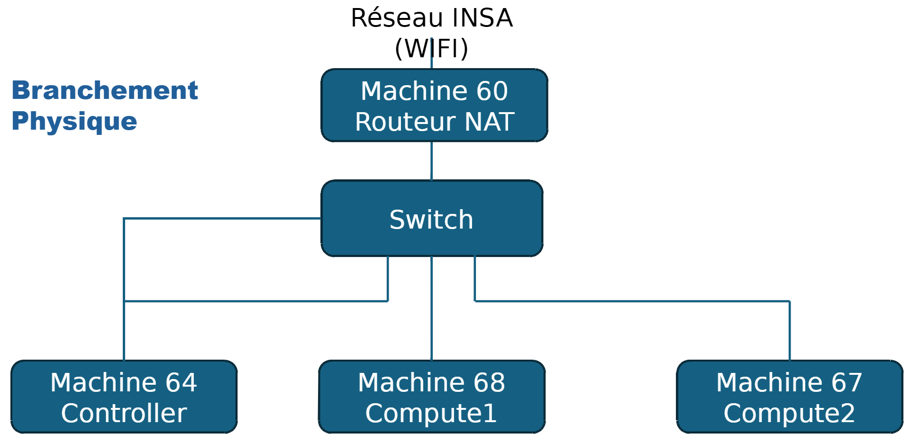

Checklist au jalon 2 : OpenStack opérationnel

- □ Réseau privé, sous-réseau et routeur ; ()
- □ Groupes de sécurité ;
- □ Paire de clés SSH ;
- □ Réseau privé, sous-réseau et routeur ;
- □ Groupes de sécurité limités au strict nécessaire ;
- □ Paire de clés SSH ;
- □ VM du cluster : 1 nœud de contrôle et au moins 2 nœuds de travail (3 si les ressources le permettent) ;
- □ VM de génération de charge ;
- □ Configuration de toutes les VM par cloud-init ;
- □ Accès SSH par floating IP ou par un bastion ;
- □ Volume Cinder et son snapshot ;
- □ Tests réseau : ping, DNS, MTU, accès Internet ou au registre local ;
- □ Script de provisioning ;
- □ Schéma réseau ;
- □ Inventaire des ressources consommées.

□ ■
